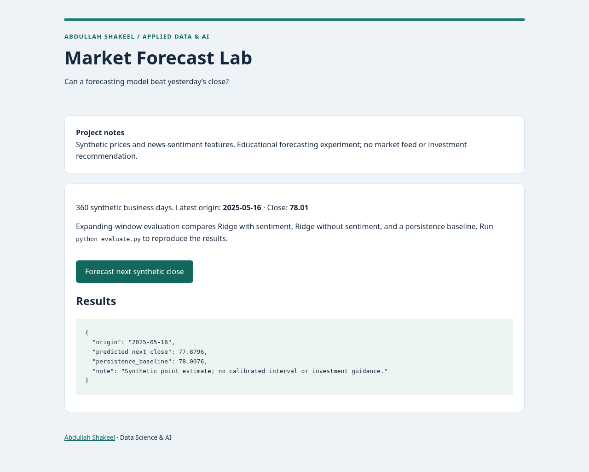

# Market Forecast Lab

I compare price-plus-sentiment forecasting with a persistence baseline using chronological, expanding-window evaluation.

**Portfolio project · Abdullah Shakeel**

Python application with reproducible setup, tests and evaluation. See [provenance and scope](PROVENANCE.md) for the implementation background.



## Problem and intended users

Developers learning leakage-aware forecasting and honest baseline comparison.

## Features and architecture

Reproducible synthetic market CSV; lagged price/return/volatility features; sentiment available at the forecast origin; expanding-window refits; Ridge model; price-only ablation and persistence baseline; saved per-origin predictions.

```text
Timestamped CSV → validation → past-only rolling features → expanding-window StandardScaler + Ridge → MAE comparison → Flask next-close demo.
```

A linear regularized model and a persistence baseline make failures easy to inspect. Fixed alpha avoids test-set hyperparameter selection. No complex time-series architecture is justified by this fixture.

## Run locally

Requires Python 3.12. From this repository directory:

```bash
python -m venv .venv
# Windows PowerShell: .venv\Scripts\Activate.ps1
. .venv/bin/activate
pip install -r requirements.txt
python app.py
```

Open http://127.0.0.1:5004 and submit the included fictional example. No credentials or external services are required. `.env.example` documents configuration, but Flask entry points use the documented fixed ports and do not load a .env file. Development servers bind to localhost. They are not production deployments.

## Validate and reproduce evaluation

```bash
pip install -r requirements-dev.txt
python -m pytest -q
python evaluate.py
```

`artifacts/evaluation.json` records the actual preparation run. Read its method alongside every metric. CI runs Python checks and evaluation on push/PR; GitHub Actions validates the application on push and pull requests. Actual desktop and mobile-width browser screenshots are in `artifacts/`. Those screenshots show the Python web interface, not a mobile binary.

## Data and provenance

See data/DATA_CARD.md. 360 artificial business days, seed 19, with an injected weak lagged sentiment relationship. No real tickers or news.

See [PROVENANCE.md](PROVENANCE.md) and [LICENSE-REVIEW.md](LICENSE-REVIEW.md). Newly authored source and fixtures use MIT; dependencies retain their own licenses. No CV numerical achievement is represented as a measured result.

## Limitations and responsible use

This is not a live stock forecasting service. Prices and sentiment are synthetic. News ingestion, actual NLP sentiment, exchange calendars, corporate actions, trading costs and calibrated uncertainty are not implemented. A model can lose to the persistence baseline. No profitable trading claim is supported.

Inputs are processed in memory; application code does not persist form contents. Standard web-server request metadata may still appear in local logs. Use fictional examples, never confidential employer, applicant, patient or billing information. No authentication or production abuse protection is included; keep this demo local.

## Future improvements

Use a licensed adjusted-price source and timestamped news with publish/ingestion times; freeze a validation protocol, add walk-forward tuning inside training only, and evaluate across regimes. Add prediction intervals and realistic costs before considering strategy research.

## Repository guide

- `core.py`: data/model or matching logic.
- `app.py`, `templates/`: local web interface.
- `evaluate.py`: reproducible evaluation and method.
- `test_app.py`: functional and boundary validation.
- `.github/workflows/validate.yml`: Python CI definition.
- `artifacts/`: actual results and screenshots.

## Project summary

Built a leakage-aware forecasting experiment with expanding-window evaluation, a sentiment ablation and a persistence baseline; documented when the simple baseline performs better.

## Dataset loading

`core.load_data(path)` accepts a chronological CSV with `date`, positive `close`, and `sentiment` in [-1,1], at least 100 rows, finite numbers and no duplicate dates. Supply only legally obtained data with origin-time availability recorded. `core.make_data()` reproduces the included fixture. `artifacts/predictions.csv` contains every held-out origin and prediction.
